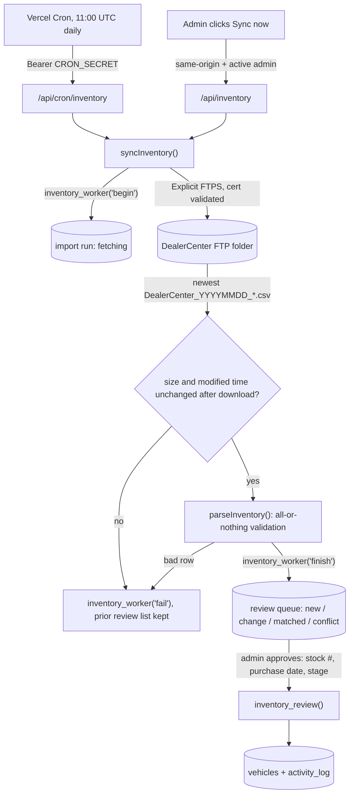

# DealerCenter inventory sync

Kars Recon pulls the dealership's inventory from DealerCenter (the dealer management system) once a day. DealerCenter publishes a CSV export to an FTP folder. Kars Recon downloads it, validates it, and puts each car into a review queue. A person approves a car before it enters the recon workflow. A fetch never adds or changes a vehicle by itself.

## 1. Trigger and authorization

There are two ways to start a sync, and both call the same function.

- **Scheduled:** [`vercel.json`](../vercel.json) runs the cron job at 11:00 UTC (6 a.m. EST / 7 a.m. EDT). The handler [`api/cron/inventory/route.ts`](../src/app/api/cron/inventory/route.ts) compares the `Authorization` header against `CRON_SECRET` using `timingSafeEqual`, so the comparison doesn't leak timing hints. A wrong secret returns 401.
- **Manual:** [`api/inventory/route.ts`](../src/app/api/inventory/route.ts) rejects requests whose `Origin` doesn't match the app. It then checks that the selected person is an active admin (`requireImportAdmin`).

The app talks to Supabase with the public (publishable) key only, so anyone could call the database functions directly. What stops a stranger from pushing a fake feed is the **worker token**. The server sends it with every `inventory_worker` call, and Postgres compares its SHA-256 hash with the single row in `private.inventory_access`. The token itself is never stored, and it isn't a Supabase service-role key. It can only run import commands. ([migration line 33](../supabase/migrations/20261106144313_inventory_import.sql#L33))

## 2. Opening a run

`inventory_worker('begin')` ([migration lines 34–41](../supabase/migrations/20261106144313_inventory_import.sql#L34-L41)) runs under a Postgres advisory lock (a named lock that the import and review commands share) and does four things:

- marks runs stuck in `fetching` for more than 5 minutes as failed (a crashed sync can't block forever),
- refuses a second concurrent sync,
- enforces a 1-minute cooldown between syncs,
- inserts a new run with status `fetching`.

## 3. Fetching the file over FTPS

[`syncInventory()`](../src/lib/inventory-server.ts#L51-L121) connects with `basic-ftp` using **Explicit FTPS**: the connection starts on port 21, then upgrades to TLS before any credentials are sent. The client sets `rejectUnauthorized: true`, so an invalid certificate aborts the connection. There is no plaintext fallback.

The hostname is `server122.web-hosting.com`, not `feed.karsautollc.com`. Both resolve to the same server, but the TLS certificate only covers the first, so certificate validation can stay on.

It lists the folder and keeps only files that match `DealerCenter_YYYYMMDD_28126551.csv` with a real calendar date ([`fileDate()`](../src/lib/inventory.ts#L24-L32)). It sorts them newest first and rejects anything empty or over 2 MB.

**Stable-file check:** before downloading, it records the file's size and last-modified time. It downloads into memory with a running 2 MB cap, then checks that the bytes received equal the size, and that the size and modified time on the server haven't changed. If any check fails, DealerCenter was probably still writing the export, and the sync stops instead of importing a partial file. ([lines 74–92](../src/lib/inventory-server.ts#L74-L92))

The source folder is read only from Kars Recon's side. Nothing is written, moved or deleted on the FTP server.

## 4. Validating the CSV

[`parseInventory()`](../src/lib/inventory.ts#L33-L122) is **all-or-nothing**. One bad row rejects the whole file and leaves the previous review list in place.

- Required headers must be present, with no duplicates: `AccountID, VIN, Year, Make, Model, Odometer, PhotoURLs`.
- Between 1 and 5,000 rows.
- `AccountID` must be the dealership's account, so a feed for another dealer can't be imported.
- VINs: 17 characters, uppercase, no I/O/Q.
- Year is 4 digits between 1900 and 2100, and mileage is a whole number.
- Text fields have length limits.
- Photo URLs must be `https://imagesdl.dealercenter.net/...`, with no credentials or custom port, and at most 100 per car.

Unit tests for these rules live in [`src/lib/inventory.test.ts`](../src/lib/inventory.test.ts).

## 5. Classifying each car

`inventory_worker('finish')` ([migration lines 49–79](../supabase/migrations/20261106144313_inventory_import.sql#L49-L79)) **re-validates in Postgres** rather than trusting the app server. It refuses a file dated older than the last successful import. Then it matches each row to recon by VIN:

| Kind | Meaning |
| --- | --- |
| `new` | VIN isn't in recon yet |
| `change` | VIN matches one car, but year/make/model/trim/color differ (blank feed values are ignored) |
| `matched` | VIN matches and nothing differs |
| `conflict` | VIN appears twice in the feed or in recon; must be fixed before import |

Each row gets a fingerprint (SHA-256 of its contents). If an identical row was already approved or dismissed, that decision carries forward, so admins don't re-review the same unchanged car every morning.

**Missing-car detection** (a car in recon that's no longer in the feed) is only trusted when the export is fresh (dated within 2 days and modified within 48 hours). It also requires that the row count didn't drop by more than half. Otherwise the run records why detection is paused. Missing cars are flagged, never deleted or marked sold.

## 6. Failure handling

`syncInventory()` tracks which phase it's in: connection, download, validation or database. On error it returns a fixed, safe message for that phase instead of the raw FTP error, which could include the hostname, user or other connection details. It also calls `inventory_worker('fail')` to close the run. Validation errors keep their specific message ("Row 4: invalid VIN…") because they contain no secrets and tell the admin what to fix. ([lines 106–117](../src/lib/inventory-server.ts#L106-L117))

## 7. Review and approval

On `/inventory`, an admin reviews the latest run. Approving calls `inventory_review` ([migration lines 86–133](../supabase/migrations/20261106144313_inventory_import.sql#L86-L133)):

- **Optimistic concurrency:** the request includes the item's fingerprint and, for existing cars, a snapshot of the vehicle as it was shown. If either changed since the page loaded, the approval is refused with "refresh and review".
- **New car:** requires a stock number (the suggested one is the last 6 VIN characters), the actual purchase date (not in the future) and a recon stage. Frontline isn't allowed, because a car still needs QC sign-off. The vehicles table is locked while the VIN is checked, so two admins can't create the same car.
- **Changed car:** only the fields the admin ticks are updated, only from year/make/model/trim/color, and a blank feed value can never erase existing data. Jobs, parts, pay, stages and blockers are never touched.
- Every decision is written to the append-only `activity_log`.

## Tradeoffs

- **Review-first instead of auto-import.** The feed has no stock number, purchase date or sold status, and a bad export shouldn't be able to rewrite the shop floor. The cost is one tap per car each morning.
- **Reject the whole file instead of skipping bad rows.** A partial import would make missing-car detection lie. A clear failure plus the previous day's list is safer.
- **Business rules in Postgres, not only in TypeScript.** The app uses only the public key, so the database has to be the final gatekeeper. The TypeScript checks give fast, friendly errors, and the SQL checks are the ones that can't be bypassed.
- **Pull once a day.** DealerCenter only offers a file export. A morning sync before the shop opens matches how the cars are actually used.
